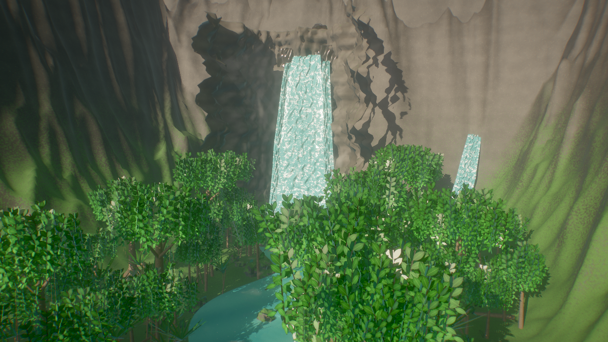
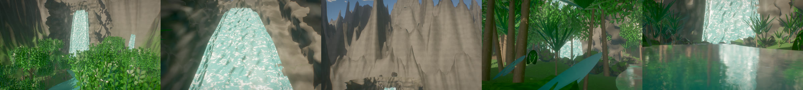
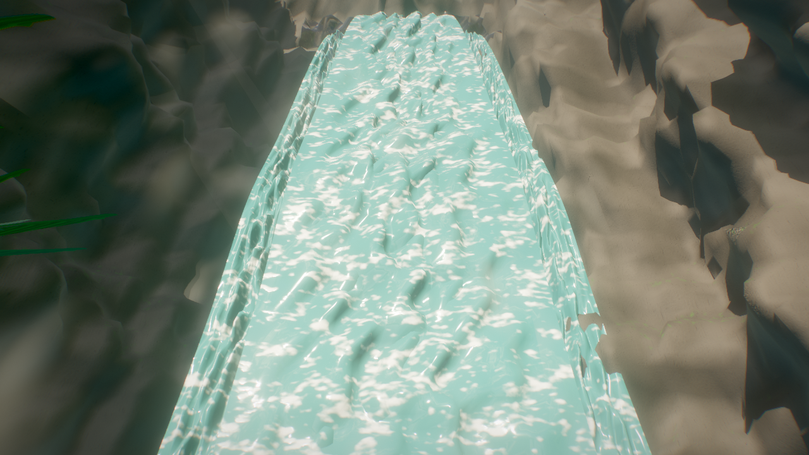
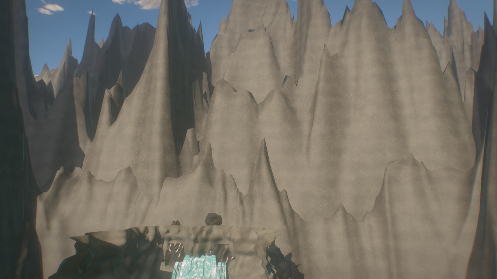
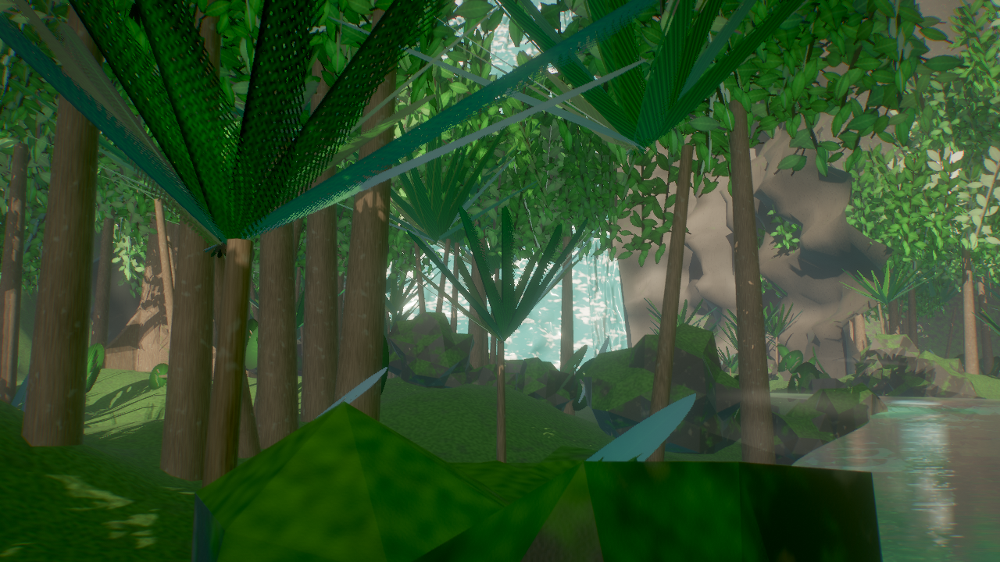
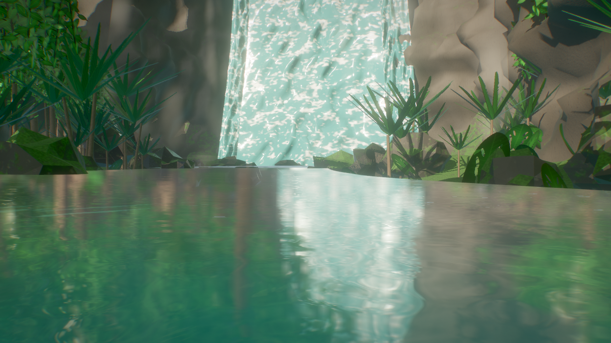

# Rainforest World

A photorealistic procedural tropical rainforest environment built entirely in code with Three.js r186, rendered in real-time and offline via headless GPU.



## What this is

Everything you see is code. The repository contains **no 3D models, no downloaded texture files, and no HDRI environment maps**. The mountains, knife-edge alpine peaks, basalt cliffs, 212m primary waterfall, secondary cascades, winding river, plunge pool, Kapok buttress-root trees, palms, tree ferns, monstera understory, and atmospheric mist are all generated procedurally in JavaScript at runtime, and every surface is procedural GLSL injected into Three.js physically based materials.

- **Pure Procedural Generation**: Continuous mathematical elevation fields, domain-warped fractal noise, ridged alpine crests, and dendritic erosion channels.
- **Deterministic**: Every procedural choice uses a seeded pseudo-random number generator (`mulberry32`), guaranteeing bit-identical world reproduction across runs.
- **Cinematic Camera System**: 5 cinematic shots covering grand valley sweeps, macro jungle framing, soaring mountain vistas, and water reflections.
- **Offline GPU Capture Pipeline**: Headless Chrome rendering toolchain (`tools/snap.mjs`, `tools/sheet.mjs`, `tools/camcheck.mjs`) supporting sub-frame anti-aliasing, motion blur, and soft shadows.

---

## Master Review Contact Sheet



*Generated via `node tools/sheet.mjs --shots 0,1,2,3,4 --t 3.5`. From left to right: Shot 0 (Grand Valley Panorama), Shot 1 (Primary Waterfall & Plunge Pool), Shot 2 (Mountain Ridges & Mist Skyline), Shot 3 (Dense Foreground Jungle & Canopy Framing), and Shot 4 (River & Plunge Pool Outflow).*

---

## Gallery

| Shot 0: Grand Valley Panorama | Shot 1: Primary 212m Waterfall |
|:---:|:---:|
|  |  |
| **Shot 2: Mountain Ridges & Skyline** | **Shot 3: Jungle Canopy Framing** |
|  |  |

<p align="center">
  <br>
  <sub><b>Shot 4: River & Plunge Pool Outflow</b> — Turquoise river surface with gentle ripples and reflections</sub>
</p>

---

## Quick Start

### Requirements

- [Node.js](https://nodejs.org) 22 or newer
- A modern browser with WebGL 2 support
- [ffmpeg](https://ffmpeg.org) on `PATH` (for contact sheets and video exports)

```bash
git clone https://github.com/MdKasif0/Rainforest-World.git
cd Rainforest-World
npm install
npm run dev
```

Open <http://localhost:5173/> in your browser. The first load compiles the procedural geometry and shaders in under 500ms.

### URL Controls & Parameters

| Parameter | Effect |
| :--- | :--- |
| *(none)* | Interactive preview mode. Orbit camera enabled. Keys `1`–`5` play shots, `space` pauses, `c` copies camera coordinates to clipboard. |
| `shot=N&t=sec` | Evaluates cinematic shot `N` (0–4) at time `t` (0–7.0 seconds). |
| `w=1920&h=1080` | Canvas width and height (default: 1280×720). |
| `spp=N` | Sub-frames per frame for anti-aliasing and soft shadows (default: 4 for stills, 1 for dev). |
| `modules=a,b,c` | Selectively builds world modules: `terrain`, `mountains`, `cliffs`, `river`, `waterfalls`, `rocks`, `vegetation`, `atmosphere`. |
| `cam=x,y,z&look=x,y,z` | Explicit camera position and target in world coordinates. |
| `focal=mm` | 35mm-equivalent lens focal length (e.g. `24`, `35`, `50`). |

---

## Procedural World Architecture

```
src/
├── main.js                  # Engine entry point, subframe loop & module coordinator
├── layout.js                # Centralized spatial coordinates, landmarks, and bounds
├── shots.js                 # 5 cinematic camera shots with smooth kinematic interpolation
├── core/
│   ├── geom.js              # Geometry builders, matrix math & mesh instancing utilities
│   ├── rng.js               # Seeded mulberry32 PRNG for deterministic world generation
│   ├── materials.js         # Procedural GLSL shaders (basalt rock, bark, foliage, water, foam)
│   ├── lighting.js          # Direct sunlight, shadow maps, and IBL environment probe
│   ├── sky.js               # Analytical atmospheric sky & cloud canopy
│   ├── fog.js               # Height-exponential aerial perspective & inscatter haze
│   └── post.js              # Cinema post-processing pipeline (exposure, tonemapping, vignette)
└── world/
    ├── terrain-field.js     # Continuous mathematical elevation field & gorge cutting
    ├── terrain.js           # 220×240 valley floor mesh & submerged riverbed gravel
    ├── mountains.js         # 2,000m mountain massif, ridged crests & skyline silhouettes
    ├── cliffs.js            # Stepped volcanic basalt amphitheater cirque (R=88m)
    ├── waterfalls.js        # 212m primary cataract with parabolic lip trajectory & cascades
    ├── river.js             # Circular plunge pool basin & Catmull-Rom river water surface
    ├── vegetation-tex.js    # Procedural 1024×1024 4-quadrant atlas (broadleaf, palm, fern, monstera)
    ├── vegetation.js        # Multi-tiered forest (Kapok emergents, hardwoods, palms, ferns, understory)
    ├── rocks.js             # Plunge pool boulders & riverbank shingle
    └── atmosphere.js        # Billowing plunge pool mist cards, humidity fog & angled sunbeams
```

---

## Offline Rendering Tools

Keep `npm run dev` running in a terminal, then execute:

```bash
# Render a single still preview
node tools/snap.mjs "shot=0&t=1.0&w=1280&h=720&spp=2" out/valley.png

# Batch render multiple views in a single GPU session
node tools/snap.mjs "w=1280&h=720&spp=2" --view "shot=0&t=1.0" out/shot0.png --view "shot=1&t=1.0" out/shot1.png

# Generate a tiled contact sheet across all shots
node tools/sheet.mjs --shots 0,1,2,3,4 --t 3.5 --tag review

# Validate camera kinematics and smoothness
node tools/camcheck.mjs
```

---

## License

MIT License.
